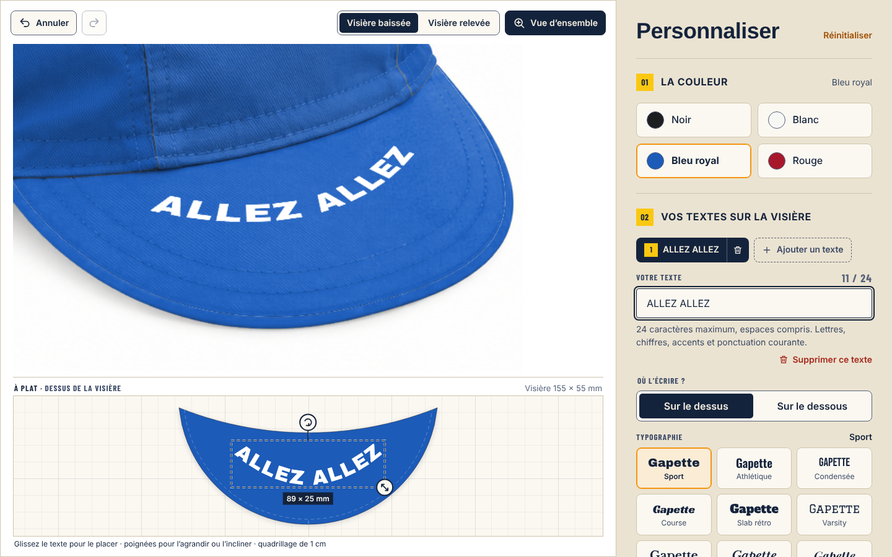
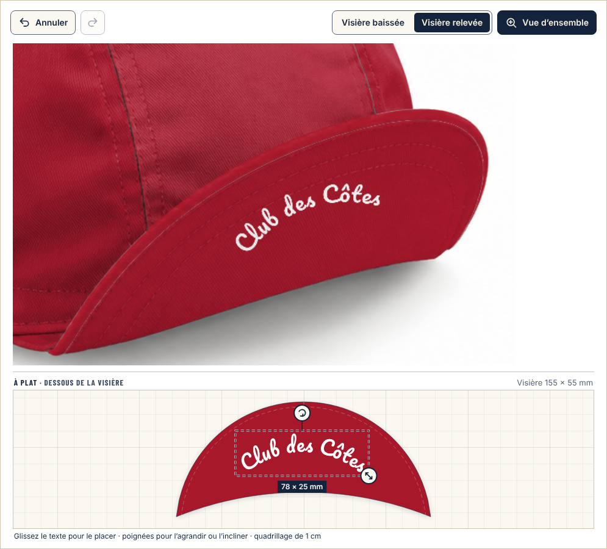
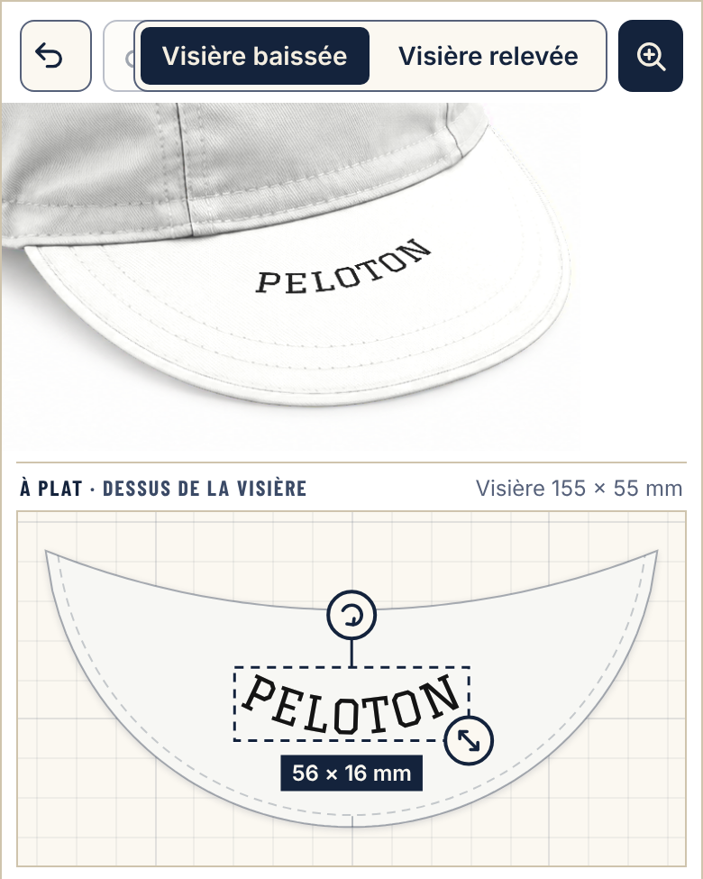

# Atelier Gapette

A cycling cap ("gapette") configurator for WordPress and WooCommerce, built for [La Gapette](https://la-gapette.fr).

Customers type their texts on a **flat view of the visor, at scale** (millimetres, 1 cm grid) and see at the same time a **realistic preview** rendered on a photograph, where the ink picks up the folds and shadows of the fabric. The configuration is stored as JSON, validated identically in the browser and on the server, and attached to the order for production.

> The user interface is in French. Code comments and documentation are in English.



<table>
<tr>
<td width="62%"></td>
<td></td>
</tr>
<tr>
<td>Underside text, read with the visor up: the flat view flips to match.</td>
<td>Mobile (390 px), touch editing.</td>
</tr>
</table>

<sub>Screenshots rendered with the La Gapette photographs, which are not part of this repository.</sub>

## Features

- Up to 3 texts, on the top or the underside of the visor; 12 locally served fonts (SIL OFL 1.1, Permanent Marker under Apache 2.0); colour, outline, size, curvature and rotation; move with mouse, touch or keyboard (1 mm per arrow key).
- Flat view: drag, size and rotation handles, live dimensions in mm, overhang highlighted.
- Three-quarter preview with the visor down / up, Canvas 2D rendering on a "zone" photograph.
- Plain cap in 4 colours (black, white, royal blue, red) or full mode (12 patterns, 5 surface colours).
- WooCommerce: variable product synced with the configurator, two different personalisations = two cart lines, configurable quantity discount, preview image in the cart, order and emails, workshop email with JSON + sha256 fingerprint, HPOS and block Cart / Checkout compatible.
- Optional GA4 tracking (`config_started`, `config_add_to_cart`, `feature_interest`…). Typed text is never sent.
- Without WooCommerce: `[atelier_gapette]` shortcode.

## Installation

1. Add a zone photograph as `assets/img/cap-materials.png`: **it is not included** (see [`assets/img/README.md`](assets/img/README.md)).
2. Zip the plugin folder, then Plugins → Add New → Upload.
3. WooCommerce → Atelier Gapette: model, cap and text colours offered, discount, reassurance lines, tracking.
4. Create the product ("Create the product as a draft" button) or tick "Atelier Gapette" on an existing product.

By default every cap colour is offered and the text colour is free (with outline). To match what you can actually print, untick colours and list the allowed text colours in the settings (one per line, e.g. `Noir #141414`).

Hooks: `atelier_gapette_cap_colors` (colour catalogue), `atelier_gapette_quantity_discount`, `atelier_gapette_materials_url`.

## Development

Sources: `assets/src/` (rendering engine, flat view, schema, UI). Distribution: `assets/dist/` (IIFE bundle + CSS prefixed with `.atelier-gapette`), committed so the plugin installs without a build step.

```sh
cd tools && npm install && node build.mjs
```

JSON schema: [`docs/schema-v3.json`](docs/schema-v3.json) (v1 and v2 are still accepted and converted). Settings, private storage and full changelog: [`readme.txt`](readme.txt).

## License

GPL v2 or later (see `LICENSE`). Font licenses are in `assets/fonts/`.
